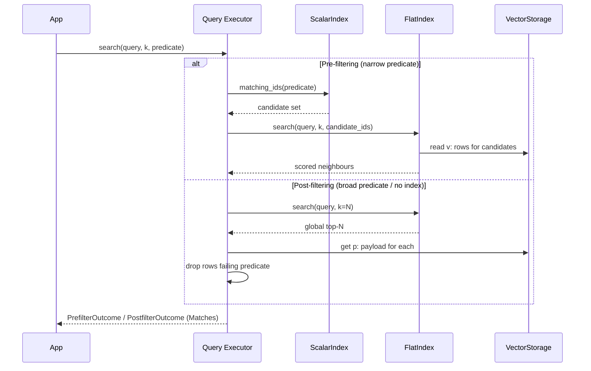

<p align="center">
  <a href="./README.zh-CN.md"></a>
  <a href="./README.md"></a>
</p>

<h1 align="center">sable-vector</h1>

<p align="center">
  <b>Embedded hybrid vector search for local AI agent runtimes.</b><br/>
  Crash-safe durability from <a href="https://github.com/MKA930/sable">sable</a> LSM · NumPy matrix math for exact recall · scalar pre/post-filtering on an inverted index.
</p>

<p align="center">
  <a href="https://github.com/MKA930/sable-vector/releases"></a>
  
  
  
  <a href="https://github.com/MKA930/sable"></a>
</p>

---

sable-vector is a single-process, dependency-light vector engine for agents that
already own an embedding model and need their vectors to **survive the process
that produced them**. It keeps three concerns strictly separate:

- **Durability** belongs to [`sable`](https://github.com/MKA930/sable) — a
  pure-Python LSM engine. Every mutation reaches a write-ahead log before it is
  visible, so a killed process loses only unacknowledged writes, never committed
  data.
- **Geometry** belongs to NumPy. Similarity is a matrix–vector product; the
  kernels here never loop over vectors in Python.
- **Filtering** belongs to a scalar inverted index materialised as ordinary
  sorted keys, so a metadata predicate becomes a prefix scan rather than a table
  walk.

Nothing opens a socket, spawns a thread behind your back, or embeds a model. It
is a library, not a service.

## Features

- **Hybrid retrieval** — combine dense vector similarity with scalar metadata
  filters through two explicit strategies: *pre-filtering* (candidate set pruned
  by the inverted index before scoring) and *post-filtering* (global top-N, then
  predicate check).
- **Crash-safe writes** — a vector, its payload and its inverted entries are
  written as one durable unit; recovery rebuilds the in-memory index from the
  WAL/SSTables on open.
- **Exact, not approximate** — the Flat index scores every candidate, so recall
  is 100% by construction; IVF clustering is provided for partition pruning on
  larger collections.
- **Standard adapter** — a `VectorStore` implementation for the LangChain-style
  `add_texts` / `similarity_search` contract, runnable fully offline with local
  NumPy embeddings.
- **Zero runtime services** — no server, no network, no external vector DB.

## Architecture

The engine is a thin, typed facade over one `sable` LSM tree. Every concern —
vectors, payloads, the scalar index, IVF centroids and posting lists — lives in
the same key space, separated only by key prefix, so there is one WAL, one
manifest and one crash-recovery story.

```mermaid
flowchart TB
    subgraph write["Write path (VectorEngine)"]
        U[upsert / delete] --> A[stage vector v:&lt;id&gt; · sync=False]
        A --> B[stage index idx:&lt;field&gt;:&lt;val&gt;:&lt;id&gt; · sync=False]
        B --> C[commit payload p:&lt;id&gt; · sync=True]
        C --> WAL[(sable WAL + memtable)]
    end
    WAL --> SST[(SSTables)]
    WAL --> IDX[(VectorStorage namespace adapter)]
    IDX -->|v:| VEC[float32 images]
    IDX -->|p:| PAY[JSON payloads]
    IDX -->|idx:| INV[scalar inverted index]
    IDX -->|c:/b:| IVF[IVF centroids / posting lists]

    subgraph read["Read path"]
        Q[query vector + predicate] --> PF{Prefilter or Postfilter?}
        PF -->|pre| PRE[ScalarIndex.matching_ids → candidate set]
        PF -->|post| POS[FlatIndex top-N → predicate check]
        PRE --> FLAT[FlatIndex.search(candidate_ids)]
        POS --> ATT[attach payloads]
        FLAT --> M[Matches with score + distance + payload]
    end
    VEC -.-> FLAT
    PAY -.-> ATT
    INV -.-> PRE
```

### Hybrid retrieval execution plan

The two filter strategies are not interchangeable; the engine exposes both so the
caller picks the one whose failure mode it can tolerate.



## Quickstart

```python
import numpy as np
from sable_vector.engine import VectorEngine
from sable_vector.query.prefilter import PrefilterExecutor
from sable_vector.index.scalar import ScalarIndex
from sable_vector.index.flat import FlatIndex

engine = VectorEngine.open(
    "collection.sv",
    metric="cosine",
    indexed_fields=("tenant", "lang"),
)
engine.upsert("doc-1", np.random.randn(1536).astype("float32"),
              payload={"tenant": "acme", "lang": "en"})
engine.upsert("doc-2", np.random.randn(1536).astype("float32"),
              payload={"tenant": "acme", "lang": "zh"})

flat = FlatIndex.materialise(engine, metric="cosine")
scalar = ScalarIndex(engine.storage, ("tenant", "lang"))
executor = PrefilterExecutor(engine.storage, flat, scalar)

outcome = executor.search(np.random.randn(1536).astype("float32"), k=5,
                          predicate={"tenant": "acme"})
for match in outcome.matches:
    print(match.id, round(match.score, 4), match.payload)
```

### LangChain-style adapter (offline)

```python
from sable_vector.adapter.langchain import SableVectorStore

store = SableVectorStore.from_texts(
    texts=["local retrieval", "hybrid search"],
    embedding=lambda texts: [np.random.randn(1536).tolist() for _ in texts],
    collection_home="rag.sv",
    metric="cosine",
    indexed_fields=("kind",),
)
hits = store.similarity_search("local retrieval", k=2)
```

The adapter never calls a remote embedding API: pass a local callable that
returns NumPy/List[float] vectors, and the full `add_texts` →
`similarity_search` loop runs end to end on one machine.

## Installation

```bash
python -m venv .venv && source .venv/bin/activate
pip install -e .
pip install "sable @ git+https://github.com/MKA930/sable.git@v0.1.1"
pytest -q
```

## Container

```bash
docker build -t sable-vector .
docker run --rm sable-vector pytest -q          # validates the build
```

## Project layout

| Path | Responsibility |
| --- | --- |
| `src/sable_vector/engine.py` | Durable upsert / delete / reclaim |
| `src/sable_vector/storage.py` | `sable` namespace adapter (`v:` / `p:` / `idx:`) |
| `src/sable_vector/distance.py` | NumPy L2 / cosine / dot kernels |
| `src/sable_vector/codec.py` | float32 zero-copy encode / decode |
| `src/sable_vector/index/` | Flat, scalar inverted, IVF clustering & posting lists |
| `src/sable_vector/query/` | Pre-filter and post-filter executors |
| `src/sable_vector/adapter/` | `VectorStore` protocol adapter |
| `src/sable_vector/recovery.py` | Crash rebuild & index health |

## Documentation & governance

- Architecture and usage: this README and [简体中文](./README.zh-CN.md)
- Contributor guide: [CONTRIBUTING.md](./CONTRIBUTING.md)
- Security policy: [SECURITY.md](./SECURITY.md)
- Release history: [CHANGELOG.md](./CHANGELOG.md)
- v0.1.0 announcement: [docs/RELEASE_NOTES_v0.1.0.md](./docs/RELEASE_NOTES_v0.1.0.md)

## License

[MIT](./LICENSE).
