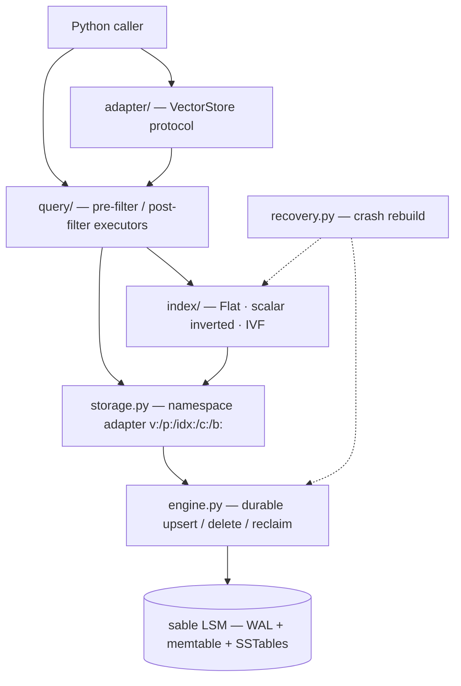
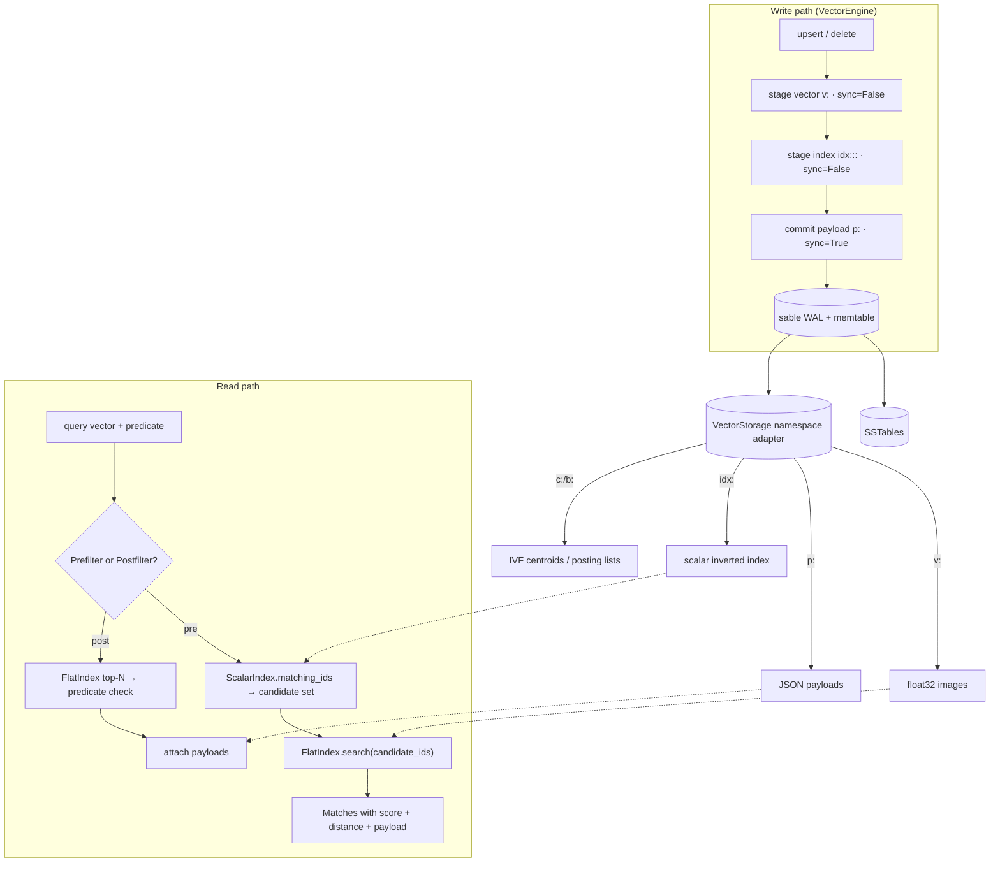
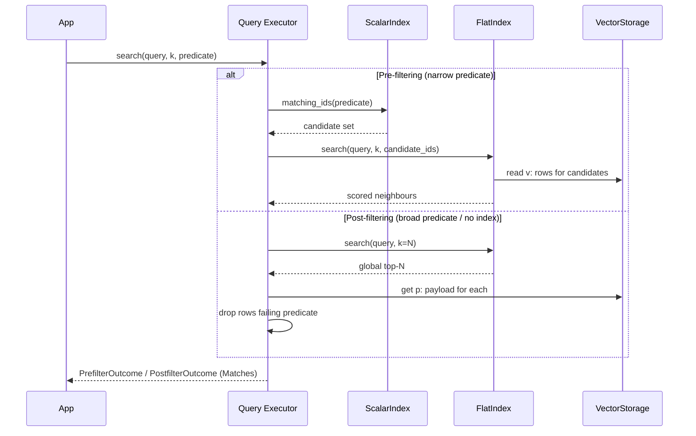

<p align="center">
  <a href="./README.zh-CN.md"></a>
  <a href="./README.md"></a>
</p>

<h1 align="center">sable-vector</h1>

<p align="center">
  <b>Embedded hybrid vector search for local AI agent runtimes.</b><br/>
  Crash-safe durability from <a href="https://github.com/H-I-F/sable">sable</a> LSM · NumPy matrix math for exact recall · scalar pre/post-filtering on an inverted index.
</p>

<p align="center">
  <a href="https://github.com/H-I-F"></a>
  <a href="https://github.com/H-I-F/sable-vector/releases"></a>
  <a href="https://github.com/H-I-F/sable-vector/actions/workflows/ci.yml"></a>
  
  
  
  <a href="https://github.com/H-I-F/sable"></a>
</p>

---

sable-vector is a single-process, dependency-light vector engine for agents that
already own an embedding model and need their vectors to **survive the process
that produced them**. It keeps three concerns strictly separate:

- **Durability** belongs to [`sable`](https://github.com/H-I-F/sable) — a
  pure-Python LSM engine. Every mutation reaches a write-ahead log before it is
  visible, so a killed process loses only unacknowledged writes, never committed
  data.
- **Geometry** belongs to NumPy. Similarity is a matrix–vector product; the
  kernels here never loop over vectors in Python.
- **Filtering** belongs to a scalar inverted index materialised as ordinary
  sorted keys, so a metadata predicate becomes a prefix scan rather than a table
  walk.

Nothing opens a socket, spawns a thread behind your back, or embeds a model. It
is a library, not a service.

> **Built on [`sable`](https://github.com/H-I-F/sable) — with critical upstream
> bugfixes contributed.** Concurrency testing in this project surfaced a
> snapshot-read consistency defect in the storage engine itself: a pinned view
> could fail to resolve a key whose newest version post-dated the snapshot, even
> though an older visible version was still present. It was traced, reproduced in
> pure `sable`, fixed upstream and shipped as `sable` v0.1.1, which this project
> pins. Full write-up: [cross-layer bug hunt](./docs/case-studies/cross-layer-bugfix.md).

## Features

- **Hybrid retrieval** — combine dense vector similarity with scalar metadata
  filters through two explicit strategies: *pre-filtering* (candidate set pruned
  by the inverted index before scoring) and *post-filtering* (global top-N, then
  predicate check).
- **Crash-safe writes** — a vector, its payload and its inverted entries are
  written as one durable unit; recovery rebuilds the in-memory index from the
  WAL/SSTables on open.
- **Exact, not approximate** — the Flat index scores every candidate, so recall
  is 100% by construction; IVF clustering is provided for partition pruning on
  larger collections.
- **Standard adapter** — a `VectorStore` implementation for the LangChain-style
  `add_texts` / `similarity_search` contract, runnable fully offline with local
  NumPy embeddings.
- **Zero runtime services** — no server, no network, no external vector DB.

## Architecture

The engine is a thin, typed facade over one `sable` LSM tree. Every concern —
vectors, payloads, the scalar index, IVF centroids and posting lists — lives in
the same key space, separated only by key prefix, so there is one WAL, one
manifest and one crash-recovery story.

### Component layers



### Write and read paths



### Hybrid retrieval execution plan

The two filter strategies are not interchangeable; the engine exposes both so the
caller picks the one whose failure mode it can tolerate.



## Quickstart

```python
import numpy as np
from sable_vector.engine import VectorEngine
from sable_vector.query.prefilter import PrefilterExecutor
from sable_vector.index.scalar import ScalarIndex
from sable_vector.index.flat import FlatIndex

engine = VectorEngine.open(
    "collection.sv",
    metric="cosine",
    indexed_fields=("tenant", "lang"),
)
engine.upsert("doc-1", np.random.randn(1536).astype("float32"),
              payload={"tenant": "acme", "lang": "en"})
engine.upsert("doc-2", np.random.randn(1536).astype("float32"),
              payload={"tenant": "acme", "lang": "zh"})

flat = FlatIndex.materialise(engine.storage, metric="cosine", dim=engine.dim)
scalar = ScalarIndex(engine.storage, ("tenant", "lang"))
executor = PrefilterExecutor(engine.storage, flat, scalar)

outcome = executor.search(np.random.randn(1536).astype("float32"), k=5,
                          predicate={"tenant": "acme"})
for match in outcome.matches:
    print(match.id, round(match.score, 4), match.payload)
```

### LangChain-style adapter (offline)

```python
from sable_vector.adapter.langchain import SableVectorStore

store = SableVectorStore.from_texts(
    texts=["local retrieval", "hybrid search"],
    embedding=lambda texts: [np.random.randn(1536).tolist() for _ in texts],
    collection_home="rag.sv",
    metric="cosine",
    indexed_fields=("kind",),
)
hits = store.similarity_search("local retrieval", k=2)
```

The adapter never calls a remote embedding API: pass a local callable that
returns NumPy/List[float] vectors, and the full `add_texts` →
`similarity_search` loop runs end to end on one machine.

## Usage guide

### Choosing a distance metric

`metric=` accepts `cosine`, `l2` or `dot`. Every kernel orients its score so
**higher means closer**, so downstream code can compare and sort without knowing
which geometry is in play.

| `metric=` | Measures | Typical use |
| --- | --- | --- |
| `cosine` | Angular distance over the unit sphere | Pre-normalised text embeddings (the usual case) |
| `l2` | Euclidean distance | Raw, unnormalised feature vectors |
| `dot` | Negative dot product | Maximum-inner-product search, retrieval over magnitudes that carry meaning |

### Choosing a filter strategy

Both executors take the same arguments and return a `Matches` list; they differ
in where the predicate is applied, which decides their failure modes.

| | `PrefilterExecutor` | `PostfilterExecutor` |
| --- | --- | --- |
| How | `ScalarIndex` narrows the candidate set first, then `FlatIndex` scores only survivors | `FlatIndex` computes the global top-N, then the predicate discards rows |
| Best when | The predicate is **selective** (`tenant`, `kind`, `lang`) and the field is indexed | The predicate is **broad**, or the corpus is small enough to spare a wider scan |
| Failure mode | Only looks at indexed prefix keys — rows missing the index entry are invisible to it | Can return fewer than `k`, because the global top-N may contain near-neighbours that all fail the predicate |

A field must be passed to `VectorEngine.open(indexed_fields=...)` for the
pre-filter path to be able to use it. Indexed fields are metadata on the write
path, not schema: adding one later requires a rebuild of the existing corpus.

### Approximate search with IVF

The Flat index scores every candidate, which is exact and perfectly adequate into
the tens of thousands. Past that, train an IVF index to prune to the partitions
closest to the query, and widen `nprobe` until recall is acceptable:

```python
from sable_vector.index.ivf_storage import IvfIndex
from sable_vector.types import DistanceMetric

index = IvfIndex.train(
    engine.storage,
    metric=DistanceMetric.COSINE,
    dim=1536,
    partitions=32,
)
outcome = index.search(query, k=10, nprobe=4)
print(outcome.matches, outcome.buckets_scanned)
```

`nprobe=1` reads a single partition and is the fastest; `nprobe == partitions`
degenerates to a full scan. The benchmark reports the latency/recall curve so
you can pick the operating point against your own data:

```bash
python -m benchmarks.bench_vector --dim 1536 --sizes 10000
```

### Durability and maintenance

Every mutation is staged unsynced and made durable by the payload commit, so a
kill during an upsert leaves either nothing or a complete record — never a
vector without its payload. Opening a collection rebuilds the in-memory indexes
from the WAL and SSTables automatically.

If you ever want to reconcile derived data by hand (torn writes, entries left by
a previous crash), one pass is enough:

```python
report = engine.reclaim()
print(report.orphan_vectors, report.orphan_payloads)
```

## Installation

```bash
python -m venv .venv && source .venv/bin/activate
pip install -e .
pip install "sable @ git+https://github.com/H-I-F/sable.git@v0.1.1"
pytest -q
```

## Container

```bash
docker build -t sable-vector .
docker run --rm sable-vector pytest -q          # validates the build
```

## Model Context Protocol

Expose a collection to any MCP-capable agent host over stdio.

```bash
pip install "sable-vector[sable,mcp]"
sable-vector serve-mcp
```

The server advertises three tools:

| Tool | Purpose |
| --- | --- |
| `sable_vector_search` | Search by embedding, optionally narrowed by payload equality filters (hybrid retrieval) |
| `sable_vector_upsert` | Write one record — embedding plus JSON attributes — as one durable unit |
| `sable_vector_describe` | Report record count, vector width and distance metric |

The **caller supplies its own embeddings**; this server never computes them.
`sable-vector serve-mcp` blocks for as long as the transport is open and returns
when the client disconnects.

> `mcp` is pinned to `<2`. The server is built on the low-level
> `Server.list_tools` / `Server.call_tool` decorator API, which mcp 2.x replaced
> with constructor callbacks. Migrating is a deliberate step, not a surprise.

## Project layout

| Path | Responsibility |
| --- | --- |
| `src/sable_vector/engine.py` | Durable upsert / delete / reclaim |
| `src/sable_vector/storage.py` | `sable` namespace adapter (`v:` / `p:` / `idx:`) |
| `src/sable_vector/distance.py` | NumPy L2 / cosine / dot kernels |
| `src/sable_vector/codec.py` | float32 zero-copy encode / decode |
| `src/sable_vector/index/` | Flat, scalar inverted, IVF clustering & posting lists |
| `src/sable_vector/query/` | Pre-filter and post-filter executors |
| `src/sable_vector/adapter/` | `VectorStore` protocol adapter |
| `src/sable_vector/recovery.py` | Crash rebuild & index health |

## Documentation & governance

- Architecture and usage: this README and [简体中文](./README.zh-CN.md)
- Contributor guide: [CONTRIBUTING.md](./CONTRIBUTING.md)
- Security policy: [SECURITY.md](./SECURITY.md)
- Release history: [CHANGELOG.md](./CHANGELOG.md)
- Evolution ledger (one tick per PR): [PROGRESS.md](./PROGRESS.md)
- v0.1.1 announcement: [docs/RELEASE_NOTES_v0.1.1.md](./docs/RELEASE_NOTES_v0.1.1.md)
- v0.1.0 announcement: [docs/RELEASE_NOTES_v0.1.0.md](./docs/RELEASE_NOTES_v0.1.0.md)
- Case study — the cross-layer bug hunt: [docs/case-studies/cross-layer-bugfix.md](./docs/case-studies/cross-layer-bugfix.md)

## License

[MIT](./LICENSE).
