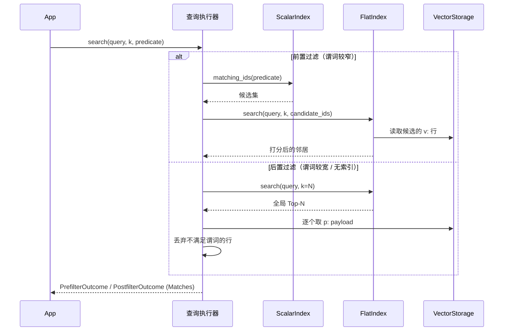

<p align="center">
  <a href="./README.md"></a>
  <a href="./README.zh-CN.md"></a>
</p>

<h1 align="center">sable-vector</h1>

<p align="center">
  <b>面向本地 AI Agent 运行时的嵌入式混合检索向量引擎。</b><br/>
  持久化由 <a href="https://github.com/MKA930/sable">sable</a> LSM 提供崩溃安全 · NumPy 矩阵运算保证精确召回 · 标量倒排索引实现前置/后置过滤。
</p>

<p align="center">
  <a href="https://github.com/MKA930/sable-vector/releases"></a>
  
  
  
  <a href="https://github.com/MKA930/sable"></a>
</p>

---

sable-vector 是一个单进程、轻依赖的向量引擎，面向**已经拥有自有 embedding 模型**、并希望向量能**在产出它们的进程崩溃后依然存活**的 Agent。它把三件事严格拆开：

- **持久化**交给 [`sable`](https://github.com/MKA930/sable)——一个纯 Python 的 LSM 引擎。每次写入先落 WAL 再可见，因此被强杀的进程只会丢未确认的写，不会丢已提交的数据。
- **几何计算**交给 NumPy。相似度就是矩阵–向量乘积，内核从不在 Python 层对向量做循环。
- **过滤**交给标量倒排索引，它被实现成普通的排序键，于是元数据谓词变成一次前缀扫描，而非全表遍历。

它不开 socket、不在你背后起线程、也不内嵌任何模型。它是库，不是服务。

## 特性

- **混合检索**——通过两种显式策略把稠密向量相似度与标量元数据过滤结合：*前置过滤*（先由倒排索引裁剪候选集再打分）与*后置过滤*（先取全局 Top-N 再做谓词判定）。
- **崩溃安全写入**——向量、payload 与倒排条目作为一个持久化单元写入；恢复时在 `open` 阶段从 WAL/SSTable 重建内存索引。
- **精确而非近似**——Flat 索引对全部候选打分，因此召回率按构造为 100%；同时提供 IVF 聚类用于对更大规模集合做分区剪枝。
- **标准适配器**——实现 LangChain 风格的 `add_texts` / `similarity_search` 协议，可完全离线运行（使用本地 NumPy embedding）。
- **零运行时服务**——无服务器、无网络、无外部向量库。

## 架构

引擎是单棵 `sable` LSM 树之上的一层薄而带类型的门面。向量、payload、标量索引、IVF 质心与倒排列表都存在于同一个键空间，仅靠键前缀区分——因此只有一份 WAL、一份 manifest、一套崩溃恢复逻辑。

```mermaid
flowchart TB
    subgraph write["写入路径 (VectorEngine)"]
        U[upsert / delete] --> A[写入向量 v:&lt;id&gt; · sync=False]
        A --> B[写入索引 idx:&lt;field&gt;:&lt;val&gt;:&lt;id&gt; · sync=False]
        B --> C[提交 payload p:&lt;id&gt; · sync=True]
        C --> WAL[(sable WAL + memtable)]
    end
    WAL --> SST[(SSTables)]
    WAL --> IDX[(VectorStorage 命名空间适配器)]
    IDX -->|v:| VEC[float32 向量]
    IDX -->|p:| PAY[JSON payload]
    IDX -->|idx:| INV[标量倒排索引]
    IDX -->|c:/b:| IVF[IVF 质心 / 倒排列表]

    subgraph read["读取路径"]
        Q[query 向量 + 谓词] --> PF{前置 还是 后置 过滤?}
        PF -->|前置| PRE[ScalarIndex.matching_ids → 候选集]
        PF -->|后置| POS[FlatIndex top-N → 谓词判定]
        PRE --> FLAT[FlatIndex.search(candidate_ids)]
        POS --> ATT[回填 payload]
        FLAT --> M[Matches: score + distance + payload]
    end
    VEC -.-> FLAT
    PAY -.-> ATT
    INV -.-> PRE
```

### 混合检索执行计划

两种过滤策略不可互换；引擎同时暴露两者，由调用方选择自己能容忍其失败模式的那种。



## 快速开始

```python
import numpy as np
from sable_vector.engine import VectorEngine
from sable_vector.query.prefilter import PrefilterExecutor
from sable_vector.index.scalar import ScalarIndex
from sable_vector.index.flat import FlatIndex

engine = VectorEngine.open(
    "collection.sv",
    metric="cosine",
    indexed_fields=("tenant", "lang"),
)
engine.upsert("doc-1", np.random.randn(1536).astype("float32"),
              payload={"tenant": "acme", "lang": "en"})
engine.upsert("doc-2", np.random.randn(1536).astype("float32"),
              payload={"tenant": "acme", "lang": "zh"})

flat = FlatIndex.materialise(engine, metric="cosine")
scalar = ScalarIndex(engine.storage, ("tenant", "lang"))
executor = PrefilterExecutor(engine.storage, flat, scalar)

outcome = executor.search(np.random.randn(1536).astype("float32"), k=5,
                          predicate={"tenant": "acme"})
for match in outcome.matches:
    print(match.id, round(match.score, 4), match.payload)
```

### LangChain 风格适配器（离线）

```python
from sable_vector.adapter.langchain import SableVectorStore

store = SableVectorStore.from_texts(
    texts=["local retrieval", "hybrid search"],
    embedding=lambda texts: [np.random.randn(1536).tolist() for _ in texts],
    collection_home="rag.sv",
    metric="cosine",
    indexed_fields=("kind",),
)
hits = store.similarity_search("local retrieval", k=2)
```

适配器从不调用远程 embedding API：传入一个本地可调用对象返回 NumPy / List[float] 向量，完整的 `add_texts` → `similarity_search` 闭环即可在单机端到端跑通。

## 安装

```bash
python -m venv .venv && source .venv/bin/activate
pip install -e .
pip install "sable @ git+https://github.com/MKA930/sable.git@v0.1.1"
pytest -q
```

## 容器

```bash
docker build -t sable-vector .
docker run --rm sable-vector pytest -q          # 校验镜像构建
```

## 目录结构

| 路径 | 职责 |
| --- | --- |
| `src/sable_vector/engine.py` | 持久化 upsert / delete / reclaim |
| `src/sable_vector/storage.py` | `sable` 命名空间适配器（`v:` / `p:` / `idx:`） |
| `src/sable_vector/distance.py` | NumPy L2 / cosine / dot 内核 |
| `src/sable_vector/codec.py` | float32 零拷贝编解码 |
| `src/sable_vector/index/` | Flat、标量倒排、IVF 聚类与倒排列表 |
| `src/sable_vector/query/` | 前置与后置过滤执行器 |
| `src/sable_vector/adapter/` | `VectorStore` 协议适配器 |
| `src/sable_vector/recovery.py` | 崩溃重建与索引健康 |

## 文档与治理

- 架构与用法：本中文文档与 [English](./README.md)
- 贡献指南：[CONTRIBUTING.md](./CONTRIBUTING.md)
- 安全策略：[SECURITY.md](./SECURITY.md)
- 发布历史：[CHANGELOG.md](./CHANGELOG.md)
- v0.1.0 发布公告：[docs/RELEASE_NOTES_v0.1.0.md](./docs/RELEASE_NOTES_v0.1.0.md)

## 许可证

[MIT](./LICENSE)。
