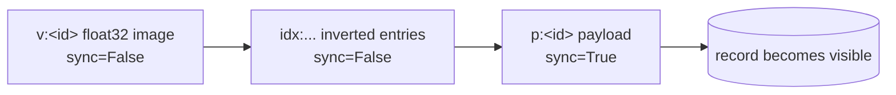
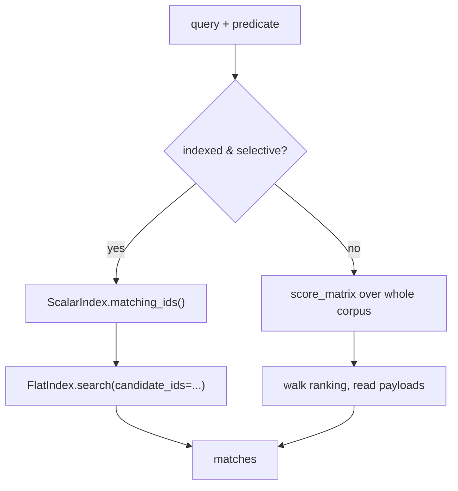

[English](vector-search-qa.md) | [简体中文](vector-search-qa.zh-CN.md)

# Hybrid retrieval, answered honestly

> Eight questions that come up when someone reads this engine's code and asks
> "why not just…". Every answer points at a real symbol in `src/sable_vector/`
> or at a measured number in [the benchmark report](../reports/benchmark-2026-11.md).
> The limits are stated as plainly as the design decisions — a vector store that
> hides its failure modes is not much use to the person debugging it at 2 a.m.

## 1. One key space, one commit boundary

### Q1. Why put vectors, payloads, inverted entries and IVF state in a single `sable` tree? Wouldn't separate files be cleaner?

Separate files are cleaner right up to the first crash. Then you need to explain
which of the three files is authoritative, and what a reader should do when the
vector file has a row the index file has never heard of. [ADR-001](../decisions/adr-001-single-keyspace.md)
picks one tree with byte prefixes that are mutually disjoint by construction:

| Prefix | Holds |
| --- | --- |
| `v:` | raw little-endian float32 image |
| `p:` | canonical JSON payload — the commit record |
| `idx:` | scalar inverted entry, `idx:<field>:<value>:<id>` |
| `c:` / `b:` | IVF centroids / posting-list members |
| `m:` | metadata |

Because the prefixes cannot overlap, a namespace scan can never leak another
namespace's keys. A metadata predicate becomes a half-open scan built by
`prefix_upper_bound()`, and `escape_segment()` stops a value containing `:` from
forging a separator. That is what makes `ScalarIndex.matching_ids()` proportional
to the size of the answer rather than to the corpus.

What you get is one WAL, one manifest and one recovery story. What you pay is
coupling: derived structures share the tree's lifetime, so `reclaim()` and
`rebuild_ivf()` clear whole namespaces instead of dropping files. Adding a prefix
is a contract change — it must be disjoint from every existing one and escaped
through the same helper.

### Q2. Why is the payload the commit record, and what is a vector with no payload?

A record exists **exactly when `p:<id>` exists**. [ADR-002](../decisions/adr-002-payload-commit-record.md)
makes that the single visibility predicate, so a reader never has to reconcile
three keys to decide whether a row is real. The write path stages everything else
unsynced and flushes once on the payload:



`_write_batch()` in `engine.py` stages every key of every record, then commits the
payloads with `sync=index == last`. A batch of 200 records therefore reaches
stable storage on one `fsync(2)`, not 600.

A `v:` with no `p:` is a **torn write**, not a record. It is derived data whose
commit never landed. `reclaim()` deletes it, and `RepairReport.orphan_vectors`
counts how many there were. The opposite — a `p:` with no `v:` — is impossible
under the documented write order, but `reclaim()` reports it as `orphan_payloads`
rather than assuming it away. `delete()` is the mirror image: it drops the payload
and inverted entries unsynced, then closes with `delete_vector(sync=True)` so an
interrupted delete leaves a detectable orphan rather than a silent half-row.

One consequence worth internalising: the direction of the invariant is fixed.
Because vectors are written *before* payloads and deleted *after* them, there is
no point in the sequence where a payload exists without its vector.
`tests/test_concurrent.py` states exactly that and forces the interleaving with
`threading.Barrier`.

## 2. Bytes and scores

### Q3. Why store raw float32 with no framing, and where does the zero-copy view stop being safe?

A 1536-dimension embedding is 6144 bytes. There is no header, no length, no
delimiter — a header would have to be parsed on every one of the rows a scan
touches, and a delimiter would have to be escaped. [ADR-004](../decisions/adr-004-float32-codec-and-score-orientation.md)
pins the dtype to little-endian `<f4` at both ends, so the layout is part of the
format rather than part of the data.

```python
def encode_vector(vector: np.ndarray) -> bytes:
    return as_query(vector).tobytes()

def decode_vector(blob: bytes, *, dim: int | None = None,
                  writeable: bool = False) -> np.ndarray:
    _check_length(blob, dim, single_row=True)
    view = np.frombuffer(blob, dtype=VECTOR_DTYPE)
    return view.copy() if writeable else view
```

`np.frombuffer` returns a **read-only view onto the bytes the storage layer
already returned** — there is no second copy. That is safe precisely because the
view is read-only: writing through it would mutate buffers the storage layer
treats as immutable. Code that needs to mutate, such as residual arithmetic in
`ivf_cluster.py`, asks for `writeable=True` and gets a private copy. The length
check happens *before* the reinterpretation; a blob that is not a whole number of
float32 items, or does not match `dim`, is a `ValueError` rather than a silent
reshape.

Payloads take the opposite route: `encode_payload()` uses canonical JSON with
sorted keys and tight separators, so equal payloads produce equal bytes. They are
parsed once per surviving hit, not once per candidate, so they can afford the
parse in exchange for being inspectable from a shell.

### Q4. Why force all three metrics to "higher is closer", and negate L2?

L2 is a distance (lower is closer); cosine similarity and dot product are
similarities (higher is closer). Every downstream consumer — `top_k`, the
executors, the ranking in a bug report — would otherwise need a branch on
`metric=`. `score_matrix()` removes it:

```python
def score_matrix(matrix, query, metric):
    if metric is DistanceMetric.L2:
        return -l2_distances(matrix, query)
    if metric is DistanceMetric.COSINE:
        return cosine_similarities(matrix, query)
    return dot_scores(matrix, query)
```

`DistanceMetric` carries the two facts that make this coherent:
`higher_is_better` (false for L2) and `worst_score` (`+inf` for L2, `-inf` for
the others) — the neutral element a top-k accumulator starts from. `Match` keeps
both quantities: `score` is the ranking key already oriented, and `distance` is
the raw geometric value for callers that need it.

Two details are deliberate. Storage is float32 but scoring accumulates in
float64, so the compact durable image does not let accumulation error reorder
near-tied neighbours. And `top_k()` uses `argpartition` (O(n)) followed by a
**stable** `argsort` over only the surviving k, so equal scores keep insertion
order instead of shuffling between otherwise identical runs.

## 3. Two ways to filter

### Q5. Why ship two executors, and when can a search return fewer than `k` rows?

Both implement `search(query, k, predicate)` and promise the same `Match` list;
they differ in *where* the predicate is applied, which decides the cost curve and
the failure mode. [ADR-003](../decisions/adr-003-dual-filter-strategies.md)
keeps both rather than picking one clever one.



| | `PrefilterExecutor` | `PostfilterExecutor` |
| --- | --- | --- |
| Order | predicate first, then score survivors | global ranking first, then predicate |
| Cost | proportional to the candidate set | always the whole corpus, plus payload reads |
| Best when | selective, indexed field (`tenant`, `lang`) | broad predicate, or a small corpus |
| Failure mode | blind to rows missing the index entry | can return fewer than `k` |

Pre-filtering raises `ValueError` if the predicate names a field that was not
declared in `VectorEngine.open(indexed_fields=...)`. Indexed fields are metadata
on the **write path**, not schema: rows written before a field was declared have
no `idx:` entry and are invisible to it. Adding one later requires a rebuild.

Post-filtering needs no index at all. It computes a full ordering with
`np.argsort(-scores, kind="stable")` — a partial sort cannot tell it which row is
next — then walks down the ranking reading payloads until it has `k` survivors.
If the top of the ranking is full of near-neighbours that all fail the predicate,
it can run out of ranking and return fewer than `k`; `PostfilterOutcome.complete`
says whether that happened, `examined` says how far it walked, and
`examine_budget` lets a latency-sensitive caller cap the walk and accept an
incomplete result.

Since both promise the same rows, `tests/test_postfilter.py` checks their
equivalence against the exhaustive flat index. A disagreement is a bug, not a
tuning difference.

### Q6. Why sort the candidate ids before gathering them? A set is cheaper.

It is cheaper and it makes results irreproducible. A Python set of strings
iterates in hash order, which is randomised per process. Gathering the candidate
rows in that order produces a different matrix block, and a different block means
different floating-point rounding in the gemv. Two candidates with exactly equal
scores then swap places depending on the hash seed — a ranking you cannot
reproduce from a bug report.

`FlatIndex.search()` therefore sorts the row positions before the gather:

```python
rows = sorted(self._positions[label]
              for label in candidate_ids
              if label in self._positions)
grid = self._matrix[rows]
```

It is a gather, not a mask: the candidate block is built once and handed to the
same kernel the unfiltered path uses. Determinism here costs one sort over the
candidate list, not over the corpus.

## 4. Approximate search, measured

### Q7. Why is IVF slower than exact search on 5,000 vectors, and how should `nprobe` be chosen?

Because approximate search is not a free faster mode. IVF pays centroid scoring
and posting-list reads *before* it scores a single vector. From
[the November 2026 run](../reports/benchmark-2026-11.md) (128 dimensions, 16
clusters, 30 queries, seed 42):

| corpus | index | nprobe | p50 (ms) | qps | recall@k |
| --- | --- | ---: | ---: | ---: | ---: |
| 1,000 | flat | — | 0.144 | 6,894 | 1.00 |
| 1,000 | ivf | 1 | 0.257 | 4,022 | 0.523 |
| 1,000 | ivf | 8 | 1.489 | 663 | 1.000 |
| 5,000 | flat | — | 3.773 | 34 | 1.00 |
| 5,000 | ivf | 1 | 0.897 | 1,124 | 0.623 |
| 5,000 | ivf | 8 | 5.860 | 167 | 0.920 |

At 1,000 vectors the resident flat index answers in 0.144 ms with recall 1.00 —
faster than IVF at *any* `nprobe`. Exact search is the right default at this
scale. `nprobe` buys recall at a predictable price: on 5,000 vectors, going from
1 to 8 partitions lifts recall 0.623 → 0.920 while p50 rises 0.897 → 5.860 ms.
`nprobe == partitions` degenerates to a full scan with exact recall, which is
also why `nprobe=8` of 16 clusters flattens the curve to 1.000 at 1,000 vectors.

The harness is self-asserting: the resident `FlatIndex` is exhaustive, so recall
is 1.0 by construction and every approximate figure is computed against it with
`_recall_at_k`. Two numbers in that report deserve the same honesty as the design
notes. The 5,000-vector resident flat row shows p50 3.773 ms but p95 **95.074 ms**
— a warm-up / allocation stall in a handful of queries, published rather than
smoothed away. And ingest (21–27k vectors/s) is an in-memory staging rate that
does not include a durable `fsync` per record. The report also lists what the run
does not cover: 1536 dimensions, `l2` and `dot`, IVF training time, concurrent
readers and durable write costs.

## 5. What is pinned, and what is not

### Q8. Why pin `mcp<2` and `sable@v0.1.1`, tell Dependabot to leave them alone, and what else is still a hard limit?

`pyproject.toml` carries `mcp>=1.9,<2` and a PEP 508 direct reference to
`sable` at tag `v0.1.1`; `.github/dependabot.yml` has a permanent `ignore` for
`mcp>=2`. [ADR-005](../decisions/adr-005-pinned-dependencies.md) pins the
dependencies that **define the API the code was written against**: unpinning
`mcp` silently trades a working stdio server for an exception on the first
handshake, and migrating to the constructor-callback API is its own release. The
direct reference is not managed by Dependabot in the first place, so upstream
fixes arrive as a deliberate tag bump plus a new `0.1.x`, which is also how
`SECURITY.md` says they are consumed. The price is age, accepted because an
automatic PR that quietly changes the API already failed once in CI. The PR
review report checks both pins on every pull request so the constraint cannot be
edited away by accident.

The rest of the boundary, unchanged in v0.1.1, is worth reading as a list rather
than discovering in production:

- one writer process per collection;
- the on-disk layout is pre-1.0 and not yet frozen;
- pre-filtering only sees fields explicitly declared as indexed;
- no embedding model is bundled;
- the MCP server is single-client stdio, with no HTTP transport or multi-tenant
  auth layer — the trust boundary is the process boundary of whoever launched it;
- each MCP tool call opens and materialises state for its collection, so
  throughput-sensitive loops should use the library API directly.

## Where to read next

| Question | Where it is answered in code |
| --- | --- |
| Key layout and prefix scans | [`storage.py`](../../src/sable_vector/storage.py), [ADR-001](../decisions/adr-001-single-keyspace.md) |
| Commit boundary and reclaim | [`engine.py`](../../src/sable_vector/engine.py), [ADR-002](../decisions/adr-002-payload-commit-record.md) |
| Codec and score orientation | [`codec.py`](../../src/sable_vector/codec.py), [`distance.py`](../../src/sable_vector/distance.py) |
| Filter strategies and their cost | [`skills/hybrid-query-strategies.md`](../skills/hybrid-query-strategies.md) |
| Choosing an operating point | [`recipes/ivf-nprobe-tuning.md`](../recipes/ivf-nprobe-tuning.md) |
| Crash rebuild | [`recovery.py`](../../src/sable_vector/recovery.py), [case study](../case-studies/cross-layer-bugfix.md) |
