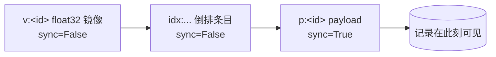
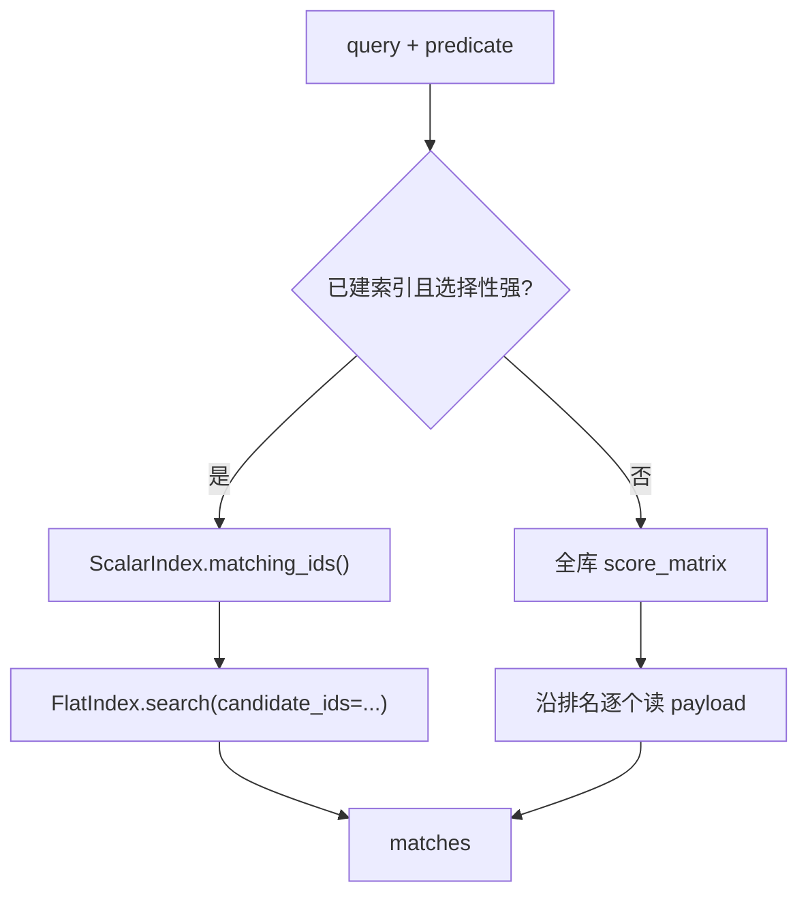

[English](vector-search-qa.md) | [简体中文](vector-search-qa.zh-CN.md)

# 混合检索：把追问回答清楚

> 读代码的人常会冒出一句「干嘛不直接……」，这里收了八个这样的问题。每个回答都指向
> `src/sable_vector/` 里真实存在的符号，或者[实测报告](../reports/benchmark.zh-CN.md)
> 里量出来的数字。设计取舍讲透，边界也照实讲——凌晨两点排障的人，最不需要的就是一份
> 把失效方式藏起来的文档。

## 一、一棵树，一条提交边界

### Q1. 向量、payload、倒排条目、IVF 状态为什么全塞进同一棵 `sable` 树？分文件不是更清爽吗？

分文件在第一次崩溃之前都很清爽。崩完之后你得回答：三个文件里哪个说了算？向量文件里
有一行、索引文件里却查无此人，读的人该怎么办？[ADR-001](../decisions/adr-001-single-keyspace.zh-CN.md)
选的是一棵树，用一组构造上就互不重叠的字节前缀隔开：

| 前缀 | 存什么 |
| --- | --- |
| `v:` | 裸的小端 float32 镜像 |
| `p:` | 规范化 JSON payload —— 提交记录 |
| `idx:` | 标量倒排条目，`idx:<field>:<value>:<id>` |
| `c:` / `b:` | IVF 质心 / 倒排桶成员 |
| `m:` | 元数据 |

前缀不可能互相包含，因此扫一个命名空间永远不会漏出别的命名空间的键。metadata 谓词
于是变成一次半开区间扫描——下界由 `prefix_upper_bound()` 给出，而 `escape_segment()`
保证值里带 `:` 也伪造不出分隔符。这才是 `ScalarIndex.matching_ids()` 的代价跟答案大小
成正比、而不是跟全库大小成正比的原因。

换来的是一份 WAL、一份 manifest、一套恢复逻辑。代价是耦合：派生结构跟这棵树同生共死，
所以 `reclaim()` 和 `rebuild_ivf()` 要清空整个命名空间，而不是删掉某个文件。新增一个前缀
属于改契约——必须与现有前缀都不重叠，并且走同一个转义函数。

### Q2. 为什么拿 payload 当提交记录？有 `v:` 没有 `p:` 算什么？

**`p:<id>` 存在，记录才存在。** [ADR-002](../decisions/adr-002-payload-commit-record.zh-CN.md)
把这一条定为唯一的可见性判据，读的人不必再去核对三份键才能判断某行到底算不算数。写路径
把其余键都暂存为 unsynced，只在 payload 上刷一次盘：



`engine.py` 里的 `_write_batch()` 先把每条记录的每个键都铺好，再提交 payload，
用 `sync=index == last` 控制：一批 200 条记录落在一次 `fsync(2)` 上，而不是 600 次。

有 `v:` 没 `p:` 是**写残了**，不是一条记录。它是提交没落地的派生数据。`reclaim()` 会删掉它，
`RepairReport.orphan_vectors` 记下删了几条。反过来「有 `p:` 没 `v:`」按文档的写入顺序不该发生，
但 `reclaim()` 照样把它记成 `orphan_payloads`，而不是当成不可能就略过。`delete()` 是镜像写法：
先把 payload 和倒排条目以 unsynced 删掉，最后用 `delete_vector(sync=True)` 收尾，这样删到一半
被打断，留下的是能被检出的孤儿，而不是一条静悄悄的半截记录。

有个方向性值得记牢：向量先于 payload 写入、晚于 payload 删除，所以整个序列里不存在
「payload 在、向量不在」的时刻。`tests/test_concurrent.py` 把这条写成不变量，再用
`threading.Barrier` 把交错强制出来。

## 二、字节与分数

### Q3. 磁盘上为什么用裸 float32、不加帧头？零拷贝视图到哪一步就不安全了？

1536 维 embedding 就是 6144 字节。没有头部、没有长度、没有分隔符——头部要在扫描碰到的
每一行上都解析一次，分隔符还得转义。[ADR-004](../decisions/adr-004-float32-codec-and-score-orientation.zh-CN.md)
把 dtype 在两端都钉成小端 `<f4`，于是布局属于格式本身，而不是数据的一部分。

```python
def encode_vector(vector: np.ndarray) -> bytes:
    return as_query(vector).tobytes()

def decode_vector(blob: bytes, *, dim: int | None = None,
                  writeable: bool = False) -> np.ndarray:
    _check_length(blob, dim, single_row=True)
    view = np.frombuffer(blob, dtype=VECTOR_DTYPE)
    return view.copy() if writeable else view
```

`np.frombuffer` 返回的是**指向 storage 层已经交出来的那块字节的只读视图**，没有第二份拷贝。
它之所以安全，恰恰因为只读：往里写，改的就是 storage 层认定不可变的缓冲区。真要改的调用方——
比如 `ivf_cluster.py` 里算残差——传 `writeable=True`，拿到一份私有副本。长度校验发生在重解释
**之前**；字节数不是 float32 的整数倍，或者跟 `dim` 对不上，直接 `ValueError`，不会悄悄 reshape。

payload 走的是另一条路：`encode_payload()` 用键排序、分隔符压紧的规范化 JSON，相等的 payload
产出相等的字节。它每个幸存结果才解析一次，不是每个候选都解析一次，所以付得起这次解析，
换来的是能在 shell 里直接看明白。

### Q4. 三种度量为什么一律「越大越近」？L2 为什么要取负？

L2 是距离（越小越近），cosine 相似度和 dot 内积是相似度（越大越近）。否则每个下游消费者——
`top_k`、两个执行器、bug 报告里的排名——都得按 `metric=` 分一支。[`score_matrix()`](../../src/sable_vector/distance.py)
把这个分支收掉了：

```python
def score_matrix(matrix, query, metric):
    if metric is DistanceMetric.L2:
        return -l2_distances(matrix, query)
    if metric is DistanceMetric.COSINE:
        return cosine_similarities(matrix, query)
    return dot_scores(matrix, query)
```

`DistanceMetric` 带着让这件事自洽的两个事实：`higher_is_better`（L2 为假）和 `worst_score`
（L2 是 `+inf`，其余是 `-inf`）——top-k 累加器的中性初值。`Match` 同时保留两个量：`score` 是
已经定向好的排名键，`distance` 是给需要几何量的调用方留的原始值。

还有两处是刻意的。存储用 float32，计分却累加在 float64 上，紧凑的持久化镜像不至于让累加误差
把分数咬得很近的邻居换了位。`top_k()` 用 `argpartition`（O(n)）挑出候选，只对留下的 k 个做
**稳定** `argsort`，同分保持插入序，不会因为跑了两遍就换个次序。

## 三、两条过滤路径

### Q5. 为什么两个执行器都发？什么时候会返回少于 `k` 条？

两者都是 `search(query, k, predicate)`，也都承诺返回同样的 `Match` 列表；差别在**谓词在哪一步
生效**，这决定了代价曲线和失效方式。[ADR-003](../decisions/adr-003-dual-filter-strategies.zh-CN.md)
选择两个都留，而不是挑一个更聪明的。



| | `PrefilterExecutor` | `PostfilterExecutor` |
| --- | --- | --- |
| 顺序 | 谓词在前，只给幸存者打分 | 全库排名在前，谓词在后 |
| 代价 | 跟候选集成正比 | 永远是全库，外加 payload 读取 |
| 适用 | 选择性强、字段已建索引（`tenant`、`lang`） | 谓词宽，或者库本来就小 |
| 失效方式 | 缺索引条目的行对它不可见 | 可能返回少于 `k` 条 |

前置过滤遇到谓词里出现了没在 `VectorEngine.open(indexed_fields=...)` 声明过的字段，会抛
`ValueError`。索引字段是**写路径**上的元数据，不是 schema：声明该字段之前写进去的行没有
`idx:` 条目，对它就是 invisible。事后补一个字段，得把已有语料重建一遍。

后置过滤完全不需要索引。它用 `np.argsort(-scores, kind="stable")` 做一次全排序——部分排序
没法告诉它下一行是谁——然后沿排名逐个读 payload，凑够 `k` 个幸存者才停。如果排在前面的
近邻全都被谓词刷掉，它可能把排名走完还是凑不够 `k`；`PostfilterOutcome.complete` 说明有没有
凑够，`examined` 记下走了多远，`examine_budget` 让对延迟敏感的调用方给这次遍历设上限、接受
一个不完整的结果。

既然两者承诺同样的行，`tests/test_postfilter.py` 就拿穷举的 flat 索引当基准，逐条核对它们
是否一致。不一致是 bug，不是调参差异。

### Q6. 候选 id 为什么要先排序再 gather？用 set 不是更省？

是更省，还会让结果没法复现。Python 的字符串 set 按哈希序迭代，而哈希种子每个进程都随机。
按这个次序 gather 出来的矩阵块就不同，块不同，gemv 里的浮点舍入也不同。两个分数恰好相等的
候选，名次会随着哈希种子互换——这种排名，你拿着 bug 报告是复现不出来的。

所以 `FlatIndex.search()` 在 gather 之前先把行号排好：

```python
rows = sorted(self._positions[label]
              for label in candidate_ids
              if label in self._positions)
grid = self._matrix[rows]
```

这是 gather 而不是 mask：候选块只组装一次，随后交给与未过滤路径同一个核。确定性在这里的
开销是对候选表排一次序，不是对全库排序。

## 四、近似检索，用数字说话

### Q7. 为什么 IVF 在 5000 条上反而比精确检索慢？`nprobe` 该怎么选？

因为近似检索不是免费的加速档。IVF 在给第一条向量打分之前，先得给质心打分、再读倒排桶。
[那次实测](../reports/benchmark.zh-CN.md)（128 维、16 个簇、30 条查询、
seed 42）给的是：

| 语料 | 索引 | nprobe | p50 (ms) | qps | recall@k |
| --- | --- | ---: | ---: | ---: | ---: |
| 1,000 | flat | — | 0.144 | 6,894 | 1.00 |
| 1,000 | ivf | 1 | 0.257 | 4,022 | 0.523 |
| 1,000 | ivf | 8 | 1.489 | 663 | 1.000 |
| 5,000 | flat | — | 3.773 | 34 | 1.00 |
| 5,000 | ivf | 1 | 0.897 | 1,124 | 0.623 |
| 5,000 | ivf | 8 | 5.860 | 167 | 0.920 |

1000 条时，常驻的 flat 索引 0.144 ms 答完、recall 1.00，比 IVF 在**任何** `nprobe` 下都快。
这个规模上，精确检索才是正确的默认值。`nprobe` 拿延迟换 recall，价格是可预期的：5000 条下
从 1 个分区加到 8 个，recall 0.623 → 0.920，p50 从 0.897 涨到 5.860 ms。`nprobe == partitions`
退化成全扫、recall 精确，这也解释了为什么 16 个簇里探 8 个，在 1000 条时曲线就平到 1.000 了。

压测脚本自带断言：常驻 `FlatIndex` 是穷举的，recall 按定义为 1.0，每个近似数字都是拿它当
ground truth、用 `_recall_at_k` 量出来的。报告里还有两个数字，值得跟设计笔记一样照实说。
5000 档的常驻 flat 行 p50 是 3.773 ms，p95 却是 **95.074 ms**——少数几条查询撞上了预热／分配
停顿，这个离群值照发，没有抹平。而 ingest 的 21–27k vectors/s 是内存里暂存的速率，不含每条
记录那次真正的 `fsync`。报告也写明了这次没覆盖什么：1536 维、`l2` 与 `dot`、IVF 训练耗时、
并发读，以及带真实 `fsync` 的写成本。

## 五、钉住的，和还没解决的

### Q8. 为什么把 `mcp<2` 和 `sable@v0.1.1` 钉死、还让 Dependabot 别碰？另外还有哪些硬边界？

`pyproject.toml` 里是 `mcp>=1.9,<2`，加上一条指向 `sable` 的 `v0.1.1` tag 的 PEP 508 直引用；
`.github/dependabot.yml` 对 `mcp>=2` 写了永久 `ignore`。[ADR-005](../decisions/adr-005-pinned-dependencies.zh-CN.md)
钉的是**定义了这份代码所针对的 API** 的依赖：把 `mcp` 放开，`stdio` 服务端会在第一次握手就
抛异常，而迁到 constructor-callback API 得单独发一个版本。直引用本来就不归 Dependabot 管，
所以上游修复是手动升一次 tag、跟着发一个新的 `0.1.x`——`SECURITY.md` 也是这么规定消费方式的。
代价是版本会变旧，接受它，是因为「一个自动 PR 悄悄改掉代码所依赖的 API」已经在 CI 上翻过车。
PR 评审报告每次都会检查这两处钉子，免得有人不小心把约束编辑掉。

v0.1.1 里其余没变的边界，值得当成一张清单先读完，别等上线再撞见：

- 每个 collection 只允许一个写进程；
- 磁盘布局还在 pre-1.0，尚未冻结；
- 前置过滤只看显式声明为 indexed 的字段；
- 不内置 embedding 模型；
- MCP 服务端是单客户端 stdio，没有 HTTP transport，也没有多租户鉴权层——信任边界就是
  启动它的那个进程的边界；
- 每次 MCP 工具调用都会为该 collection 重新 open 并物化状态，吞吐敏感的循环应该直接用库 API，
  不要走协议。

## 接着读哪儿

| 想问的事 | 代码里在哪儿 |
| --- | --- |
| 键布局与前缀扫描 | [`storage.py`](../../src/sable_vector/storage.py)、[ADR-001](../decisions/adr-001-single-keyspace.zh-CN.md) |
| 提交边界与 reclaim | [`engine.py`](../../src/sable_vector/engine.py)、[ADR-002](../decisions/adr-002-payload-commit-record.zh-CN.md) |
| 编解码与分数方向 | [`codec.py`](../../src/sable_vector/codec.py)、[`distance.py`](../../src/sable_vector/distance.py) |
| 过滤策略与代价 | [`skills/hybrid-query-strategies.zh-CN.md`](../skills/hybrid-query-strategies.zh-CN.md) |
| 定工作点 | [`recipes/ivf-nprobe-tuning.zh-CN.md`](../recipes/ivf-nprobe-tuning.zh-CN.md) |
| 崩溃重建 | [`recovery.py`](../../src/sable_vector/recovery.py)、[跨层排障记](../case-studies/cross-layer-bugfix.zh-CN.md) |
